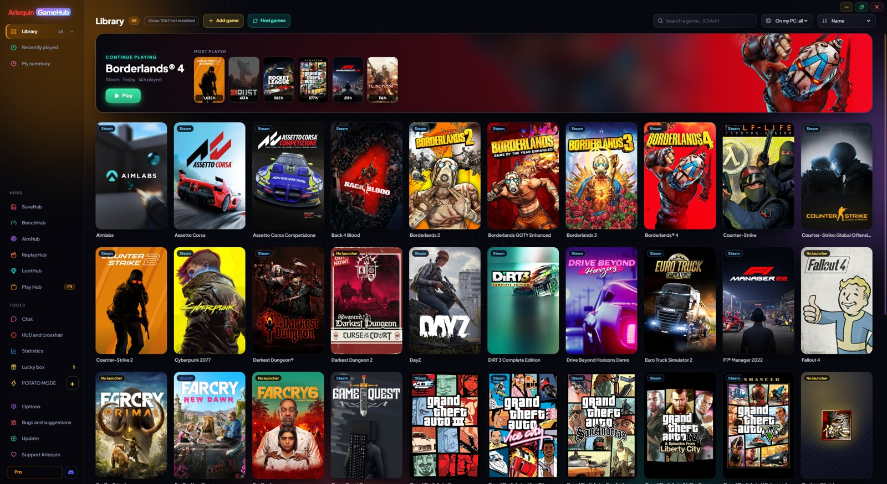
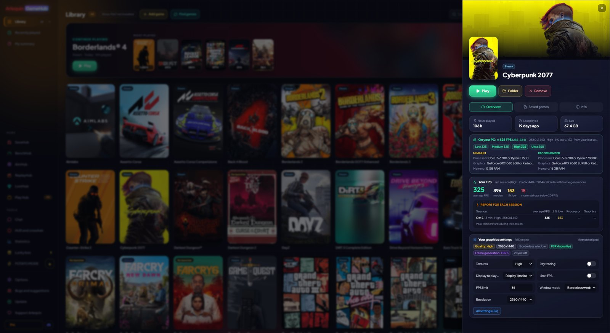
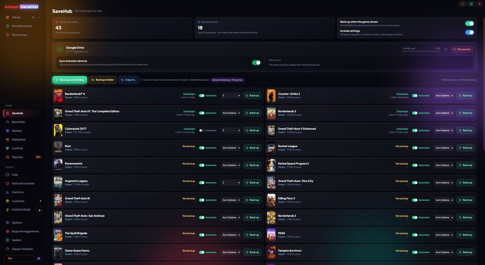
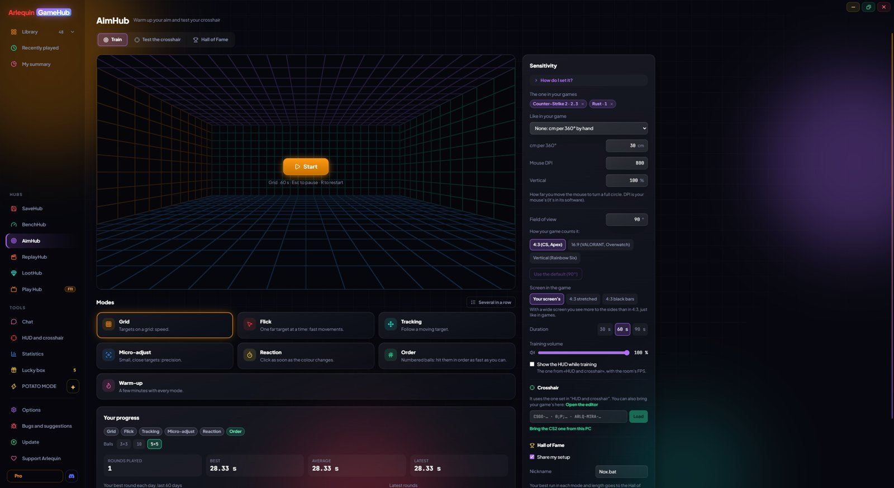
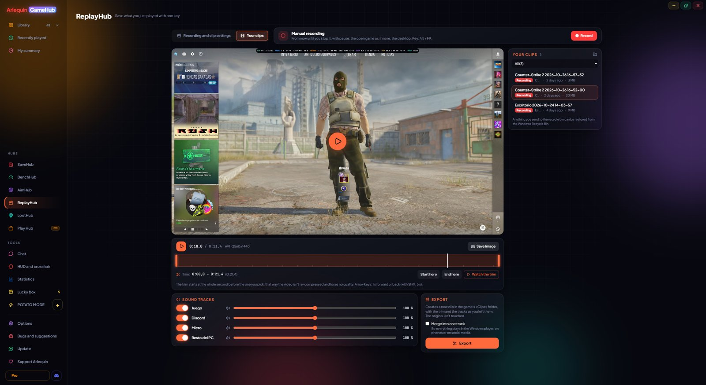
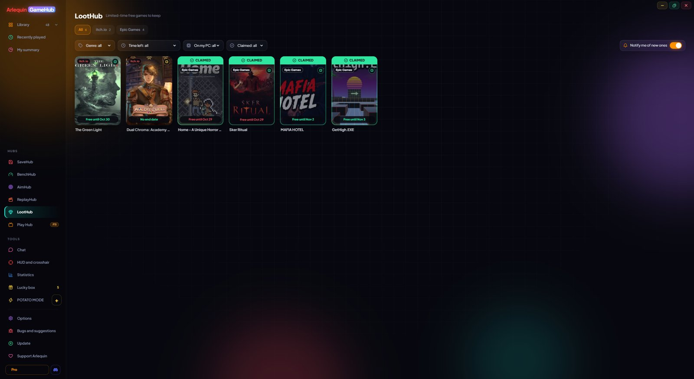
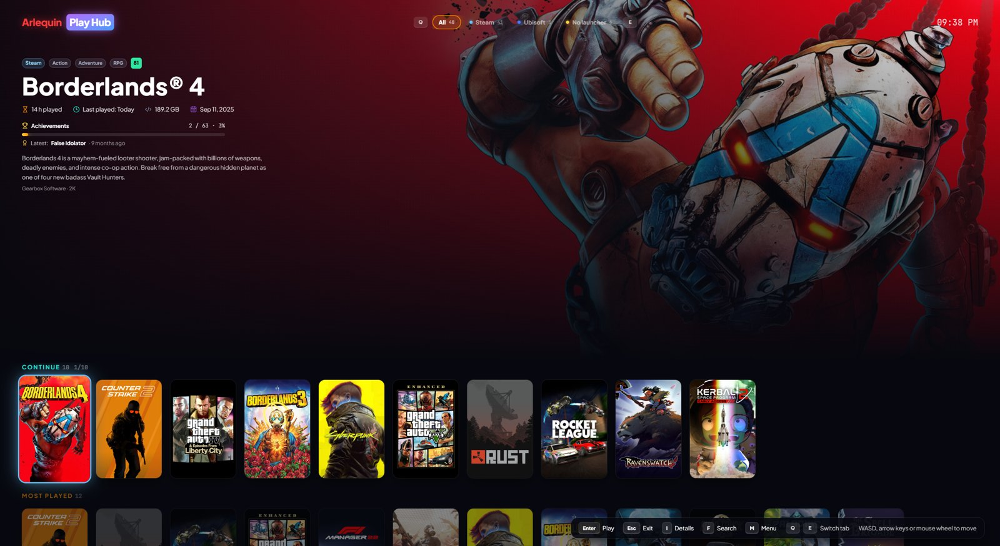
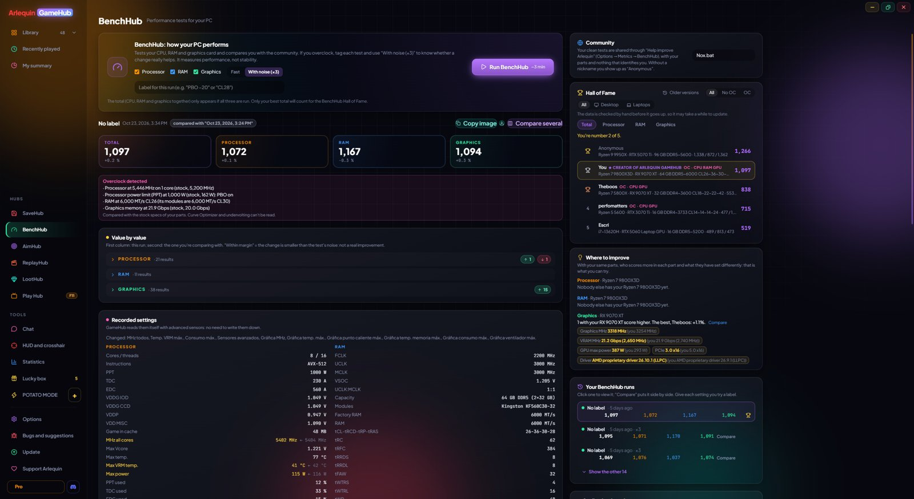
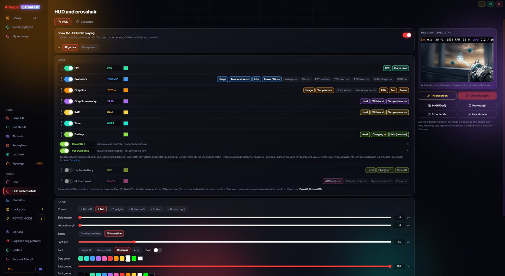

  

<h1 align="center">Arlequin GameHub</h1>

  <b>All your PC games in one launcher, with automatic save backups, FPS overlay, crosshair, clips and aim training.</b> 
  Free · No account · No ads · Windows 10/11

  <a href="https://github.com/aitor965/Arlequin-GameHub-Releases/releases/latest/download/Arlequin-GameHub-Setup.exe"><b>⬇ Download for Windows</b></a>
  &nbsp;·&nbsp;
  <a href="https://arlequinsavehub.com">Website</a>
  &nbsp;·&nbsp;
  <a href="https://github.com/aitor965/Arlequin-GameHub-Releases/releases">All versions</a>

## One library for every store

Steam, Epic Games, GOG, EA app, Ubisoft Connect, Battle.net, Amazon Games, Xbox / Game Pass, Rockstar, Riot,
HoYoPlay, Wargaming, Ankama, Gameforge, itch.io and games without a launcher, all in one place, with your hours
and achievements.

**Can I run it?** Each game page compares its requirements with your PC, estimates your FPS and lets you change
the game's graphics settings without opening it (keeping a copy of the original).

## SaveHub: never lose a save again

SaveHub backs up your saves every time you close a game and lets you go back to any copy in one click. It knows
where each game saves (including saves stored in the Windows registry), marks the copy made after a crash and can
upload your backups to your own Google Drive, OneDrive or Dropbox.

## The Hubs

| | |
|---|---|
| **AimHub** – warm up your aim in a 3D room with seven modes, using your game's sensitivity and FOV. |  |
| **ReplayHub** – save the last minutes you played with one key and edit your clips, with game, Discord and mic audio on separate tracks. |  |
| **LootHub** – free games for a limited time from Epic, Steam, GOG, itch.io, Ubisoft, EA and Prime Gaming. |  |
| **Play Hub** – full-screen couch mode to play with a controller. |  |
| **BenchHub** – benchmark your CPU, RAM and GPU and compare with the community Hall of Fame. |  |
| **HUD and crosshair** – FPS, CPU/GPU usage and temperature, RAM and controller/headset battery, plus a custom crosshair. Nothing is injected into games. |  |

Also: **DiskHub** (disk space per game and leftovers from uninstalled games), Discord / Steam / TeamSpeak chat,
"My summary" with your hours per month, store and genre, **POTATO MODE** (almost zero usage while you play) and a
Lucky box for when you don't know what to play.

## Languages

English, Spanish, Chinese, Russian, Portuguese (Brazil), German, French and Italian.

## Free and Pro

GameHub is free with no account and no ads. Some advanced extras (more backups per game, cloud sync between
several PCs, save slots…) are part of the optional ArlequinPro.

## Privacy

Your saves stay on your PC. If you allow it, GameHub anonymously shares where games save and what hardware you
have, to improve the community database. You can turn it off at any time.
[Privacy policy](https://arlequinsavehub.com/privacy-policy.html) ·
[Terms of service](https://arlequinsavehub.com/terms-of-service.html)

## Support

Report bugs and send suggestions from **Bugs and suggestions** inside the app, or visit
[arlequinsavehub.com](https://arlequinsavehub.com).

---

This repository hosts the installers and updates of Arlequin GameHub. The source code is private.
